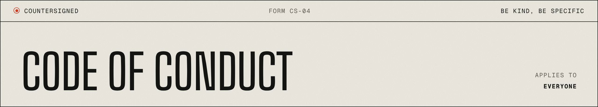

<a href="README.md">README</a> &nbsp;·&nbsp; <a href="https://akiyo974.github.io/countersigned/">Website</a> &nbsp;·&nbsp; <a href="docs/concepts.md">Concepts</a> &nbsp;·&nbsp; <a href="CONTRIBUTING.md">Contributing</a> &nbsp;·&nbsp; <a href="SECURITY.md">Security</a>

---

## § 01 · Our pledge

We want countersigned to be a welcoming project for everyone, whatever their experience, background, identity or the language they write in. English is the working language of the repository, but nobody will be judged on their English.

## § 02 · Expected behaviour

- Be kind and assume good intent.
- Critique code and ideas, never people.
- Accept that maintainers may say no, and say why when you do.
- Help newcomers find their first contribution.

## § 03 · Unacceptable behaviour

- Harassment, insults, discriminatory jokes or language.
- Personal or political attacks.
- Publishing someone's private information without permission.
- Sustained disruption of discussions.

## § 04 · Enforcement

Report problems privately to the maintainer through a GitHub Security Advisory on this repository or by direct message to [@Akiyo974](https://github.com/Akiyo974). Reports are handled confidentially.

Maintainers may remove comments, close issues, or block contributors who break this code. Consequences scale with the behaviour: a warning, a temporary ban, then a permanent ban.

## § 05 · Attribution

Adapted from the [Contributor Covenant](https://www.contributor-covenant.org), version 2.1.
