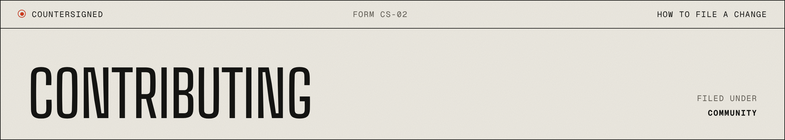

<p align="center"></p>

<p align="center"><sub><a href="README.md">README</a> &nbsp;·&nbsp; <a href="https://akiyo974.github.io/countersigned/">Website</a> &nbsp;·&nbsp; <a href="docs/concepts.md">Concepts</a> &nbsp;·&nbsp; <a href="CONTRIBUTING.md">Contributing</a> &nbsp;·&nbsp; <a href="SECURITY.md">Security</a></sub></p>

---

Thanks for looking. countersigned is small on purpose; contributions that keep it that way are the most welcome. By participating you agree to follow the [Code of Conduct](CODE_OF_CONDUCT.md).

## § 01 · Setup

Node 22.18+ runs TypeScript directly, so there is nothing to build to hack on it:

```bash
npm install          # only typescript and @types/node, for type checking
npm test             # node --test
npm run typecheck
npm run demo
```

## § 02 · Ground rules

- **Zero runtime dependencies** in the core. Adapters can live in separate packages.
- **Erasable TypeScript only** (no enums, namespaces or parameter properties) so Node can run the sources as is.
- **Every refusal is a `GateError` with a stable code** and a message written for the model reading it: say what happened and what to do next.
- **Safety behaviour needs a test that fails without it.** If you change apply, recheck, compensation or the ledger, add the scenario to `test/gate.test.ts`.
- Prefer refusing over guessing. If an outcome is unknown, report it.

## § 03 · Good first contributions

- A `Store` for SQLite (`node:sqlite`) or Postgres
- An adapter for a system you know (Business Central OData, Odoo XML-RPC, Shopify, Stripe)
- An approval channel (Slack interactive message, small web inbox)
- More policy rules (time windows, per-tag quotas, two-person rule)

## § 04 · Artwork and brand

Everything visual follows the website's "registre" look: paper `#ece9e1`, ink `#141412`, one red `#d2381b` (text `#b42d14`), Big Shoulders Display for titles, Geist and Geist Mono for the rest. No gradients, no glow, no stock imagery.

The images in `docs/assets/` are generated from real code and real runs, never drawn by hand, so they cannot drift from the product:

```bash
node site/tools/fetch-fonts.mjs                       # self-hosted fonts, once
python3 -m http.server 8765 &                         # from the repository root
node scripts/brand/render.mjs                         # banners, figures, signing.gif, ledger capture
python3 scripts/render-demo.py . docs/assets/demo.gif # terminal demo
```

`render.mjs` needs Playwright (`CHROME_PATH` to use an installed Chrome), ffmpeg and Python with Pillow.

## § 05 · Reporting a security issue

See [SECURITY.md](SECURITY.md). Please do not open a public issue for a bypass.
