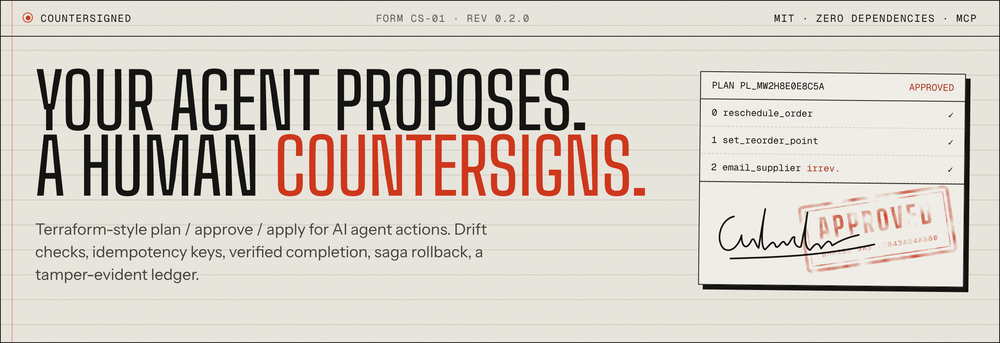
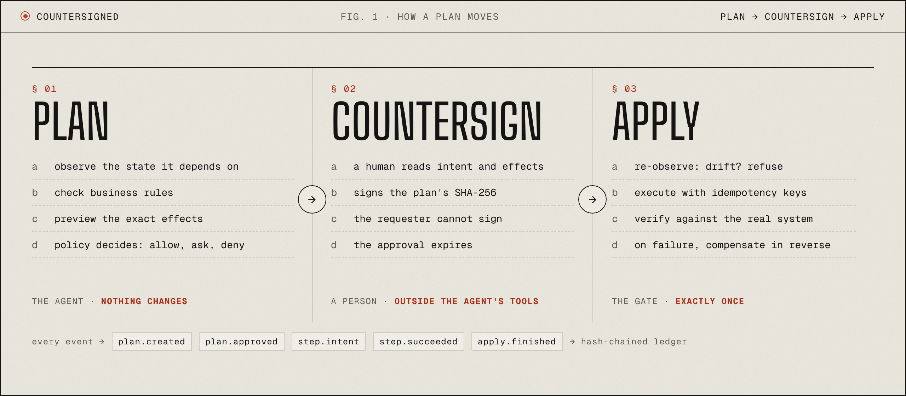
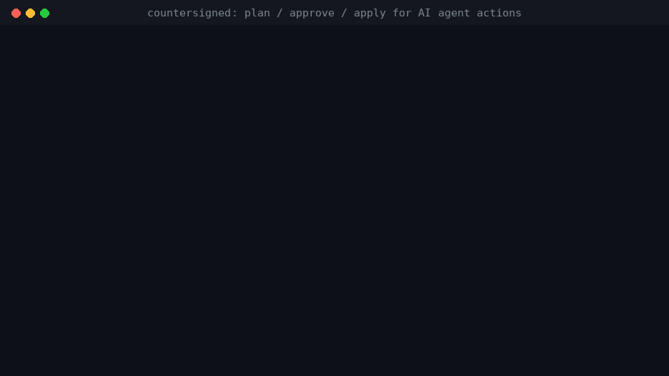
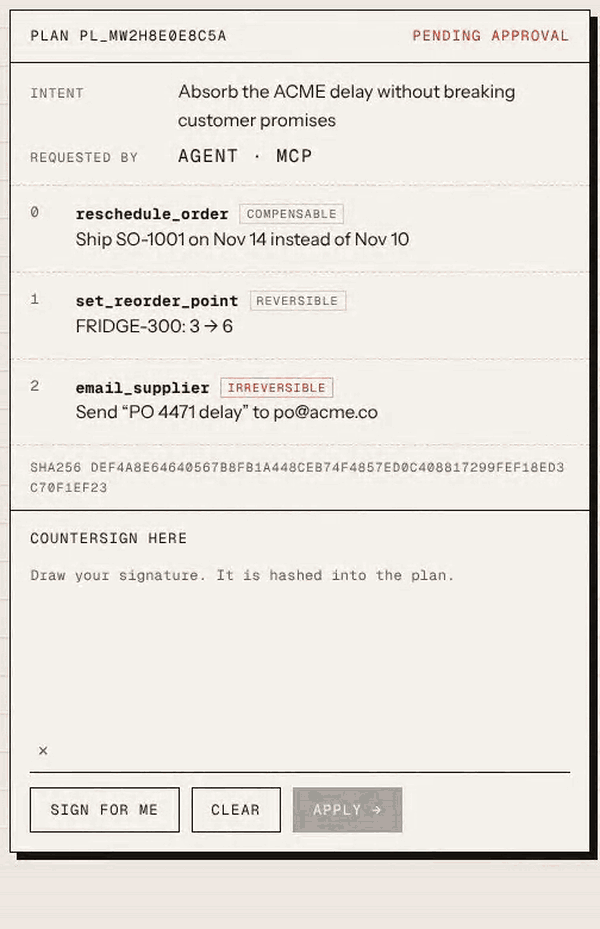
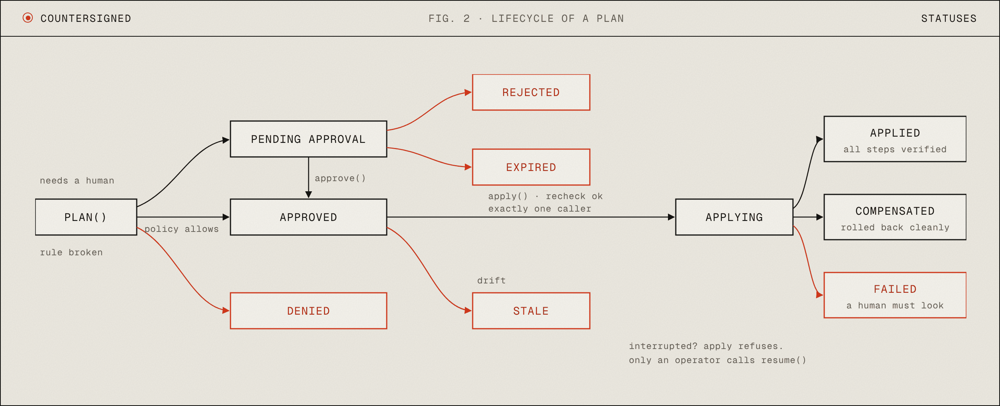
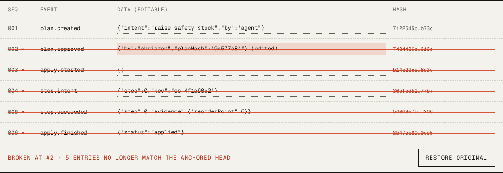

<p align="center">
  <a href="https://akiyo974.github.io/countersigned/"></a>
</p>

<p align="center">
  <a href="https://github.com/Akiyo974/countersigned/actions/workflows/ci.yml"></a>
  <a href="https://www.npmjs.com/package/countersigned"></a>
  
  
  <a href="https://github.com/Akiyo974/countersigned/blob/main/LICENSE"></a>
</p>

<p align="center">
  <b><a href="https://akiyo974.github.io/countersigned/">Sign a plan in your browser</a></b> &nbsp;·&nbsp;
  <a href="https://github.com/Akiyo974/countersigned/blob/main/docs/concepts.md">Concepts</a> &nbsp;·&nbsp;
  <a href="#-05--define-an-action">Define an action</a> &nbsp;·&nbsp;
  <a href="#-07--use-it-as-an-mcp-server">MCP</a> &nbsp;·&nbsp;
  <a href="https://github.com/Akiyo974/countersigned/blob/main/CHANGELOG.md">Changelog</a>
</p>

---

## § 01 · What it is

Your agent can read anything. When it wants to *change* something, it files a plan: the current state is read, business rules are checked, the exact effects are previewed. A human (or a policy) signs that exact plan. Then `apply` re-checks that the world has not moved, executes with idempotency keys, **verifies every step against the real system**, rolls back in reverse if anything fails, and writes it all to a tamper-evident ledger.

Zero dependencies. TypeScript. Speaks MCP out of the box, so it works with Claude, Cursor, VS Code, OpenAI Agents and anything else that talks Model Context Protocol.

<p align="center"></p>

## § 02 · See it

<p align="center"><br><sub><b>The agent side.</b> Refused until approved, applied exactly once, and a write that silently did not stick is caught and rolled back.</sub></p>

<p align="center"><br><sub><b>The human side.</b> A real signature is hashed into the plan, then every step is verified. <a href="https://akiyo974.github.io/countersigned/">Try it in your browser.</a></sub></p>

```bash
git clone https://github.com/Akiyo974/countersigned && cd countersigned
node examples/erp/demo.ts        # Node >= 22.18, nothing to install
```

The demos run an agent against a deliberately annoying fake ERP: documents locked by users, writes that report success but do not stick, emails that cannot be unsent. Every frame above comes from real runs (`scripts/render-demo.py`, `scripts/brand/render.mjs`).

## § 03 · Incident register

Agents moved from *answering* to *doing*. Writing to real systems (an ERP, a CRM, a billing API, a database) breaks in ways a better prompt cannot fix:

| What goes wrong | What countersigned does |
| --- | --- |
| The agent acts on state that changed after the human said yes | Snapshot at plan time, re-observe before apply, refuse on drift (`STALE_STATE`) |
| A retry or a crash sends the email twice, books the order twice | Stable idempotency key per step, forwarded to your system; completed steps are never repeated |
| "Done!" says the agent. It was not. | `verify()` is mandatory and re-reads the source of truth; the report carries the evidence |
| Step 3 fails, steps 1 and 2 already changed things | Saga compensation in reverse order; irreversible leftovers are flagged for a human |
| The approved plan is not the plan that runs | Approval is pinned to a SHA-256 of the plan; any edit invalidates it |
| The agent approves itself | Approval lives outside the agent's process and tools; requester cannot approve |
| "What exactly happened at 3am?" | Append-only, hash-chained ledger; `countersigned ledger verify` detects edits and deletions |

Terraform solved this for infrastructure years ago. Nobody had generalized it to the rest of the systems agents now touch.

## § 04 · Lifecycle

<p align="center"></p>

More in [Concepts](https://github.com/Akiyo974/countersigned/blob/main/docs/concepts.md): the plan hash, idempotency keys, ledger events and how to write good actions.

## § 05 · Define an action

An action is six small clauses. Writing them forces the questions that matter *before* the agent runs in production.

```ts
import { defineAction, t } from "countersigned";

export const setReorderPoint = defineAction({
  name: "set_reorder_point",
  description: "Change the reorder point of an inventory item. Reversible.",
  reversibility: "reversible", // read | reversible | compensable | irreversible
  input: t.object({ sku: t.string(), reorderPoint: t.integer({ min: 0 }) }),

  // 1. What state does this depend on? Snapshotted at plan time, re-checked before apply.
  observe: ({ sku }) => erp.getItem(sku),

  // 2. Business rules. Any violation denies the plan before a human is bothered.
  check: (input, item) => (item ? [] : ["item does not exist"]),

  // 3. What will change, in words a human can approve.
  preview: ({ sku, reorderPoint }, item) => [
    { target: `item:${sku}`, op: "update", before: item.reorderPoint, after: reorderPoint },
  ],

  // 4. Do it. Pass the idempotency key downstream.
  execute: ({ sku, reorderPoint }, { idempotencyKey }) => erp.update(sku, { reorderPoint }, idempotencyKey),

  // 5. Prove it. Re-read the system; never trust the return value alone.
  verify: ({ sku, reorderPoint }) => erp.getItem(sku)?.reorderPoint === reorderPoint,

  // The way back. Required for reversible and compensable actions.
  compensate: ({ sku }, _result, { before }) => erp.update(sku, { reorderPoint: before.reorderPoint }),
});
```

`defineAction` refuses, at boot, a writable action without a way back, an irreversible action pretending to have one, or a description too thin for a model to choose correctly.

Already using zod, valibot or ajv? Wrap it with `t.custom(jsonSchema, parse)`.

## § 06 · Use it from code

```ts
import { FileStore, rules, Gate } from "countersigned";

const gate = new Gate({
  store: new FileStore(".countersigned"),
  rules: [rules.irreversibleNeedsApproval(), rules.autoApprove("set_reorder_point"), rules.maxEffects(20)],
}).register(setReorderPoint, rescheduleOrder, emailSupplier);

const plan = await gate.plan(steps, { intent: "absorb the supplier delay", requestedBy: "agent-42" });
// plan.status: "approved" (policy allowed) | "pending_approval" | "denied"

await gate.approve(plan.id, { by: "christen" });  // or from the CLI, or your UI
const report = await gate.apply(plan.id);        // safe to call again
```

## § 07 · Use it as an MCP server

```ts
import { serveStdio } from "countersigned/mcp";
serveStdio(gate, { agentId: "claude-desktop" });
```

The agent sees `countersigned_list_actions`, `countersigned_plan`, `countersigned_get_plan`, `countersigned_apply`, plus every read-only action as a direct tool. It never sees an approve tool. Example config (Claude Desktop, Claude Code, Cursor):

```json
{
  "mcpServers": {
    "erp": { "command": "node", "args": ["/path/to/countersigned/examples/erp/mcp-server.ts"] }
  }
}
```

Then, in another terminal, the human side:

```bash
npx countersigned list                 # what is waiting
npx countersigned show pl_...          # intent, exact input, before/after, why it needs you
npx countersigned approve pl_...       # signs this exact plan hash
npx countersigned ledger verify        # chain and plan records intact?
```

## § 08 · Storage

```ts
import { FileStore, MemoryStore } from "countersigned";
import { SqliteStore } from "countersigned/sqlite";

new MemoryStore();                  // tests
new FileStore(".countersigned");    // plain files, zero setup
new SqliteStore("countersigned.db"); // transactional, built on node:sqlite (still zero dependencies)
```

Any database works: a `Store` is six async methods (`createPlan`, `getPlan`, `updatePlan`, `listPlans`, `appendLedger`, `readLedger`).

## § 09 · Policies

Rules are plain functions `(step, plan) => { decision, reason } | undefined`. Strictest opinion wins and `deny` can never be relaxed. With no rules: reads run, every write waits for a human.

Built in: `autoApprove`, `requireApproval`, `deny`, `irreversibleNeedsApproval`, `tagNeedsApproval`, `maxEffects` (blast radius), `maxAutoSteps`. A custom rule that lets small changes through:

```ts
(step) => step.action === "set_reorder_point" && Math.abs(after - before) <= 2
  ? { decision: "allow", reason: "change of 2 units or less" }
  : undefined
```

## § 10 · Guarantees, and what is not

Honest list, because safety tooling that oversells is worse than none.

<p align="center"><br><sub>Edit one ledger entry and everything after it stops matching. Try it on <a href="https://akiyo974.github.io/countersigned/#ledger">the site</a>.</sub></p>

- **Drift detection is as good as your `observe()`.** Observe exactly what the action depends on, from the source of truth.
- **The gate's recheck is time-of-check.** A change between the recheck and the write is still possible unless the target system can refuse it. Keep the version (ETag, row version) in `observe()` and send it with the write (`If-Match`): the server then rejects any last-instant change, and `execute()` throws `NotAppliedError` so the gate rolls back cleanly. [`examples/rest`](https://github.com/Akiyo974/countersigned/tree/main/examples/rest) shows the full pattern, tested.
- **Compensation is not a transaction.** It is a best effort correction. That is why reversibility is declared per action, and irreversible effects that already happened are reported as `unrecoverable` instead of hidden.
- **If `execute()` throws, the outcome is unknown.** countersigned does not guess: the step is reported for a human, the key lets you look it up. When you *know* nothing happened (a 409, 412 or 422 from the API), throw `NotAppliedError` instead.
- **An interrupted apply is never resumed implicitly.** If the process dies mid-apply, every further `apply` is refused (`APPLY_IN_PROGRESS`), so an agent cannot crash its way into a re-run. An operator calls `gate.resume(id, { by })` (not exposed over MCP): ownership is taken atomically (a second resume, or the original process if still alive, stops before its next step), finished steps are skipped, a step that started without a recorded outcome is checked with `verify()` against the real system and is never blindly re-executed, and steps that never started are re-checked for drift and expiry (overridable with `ignoreDrift` / `allowExpired` when the operator has looked).
- **FileStore and SqliteStore are single-machine.** Both are safe across processes on one host. For several hosts, implement the `Store` interface on your database (six async methods).
- **The ledger is tamper-evident, not tamper-proof.** Edits, insertions and deletions break the chain; entries cut from the end are caught because every plan records the last entry written for it (`countersigned ledger verify`). Someone able to rewrite both plans and ledger can still forge history, so publish `countersigned ledger head` somewhere the host cannot rewrite (a git commit, a log service) and verify with `--head`.

## § 11 · Status

v0.2, working and tested (71 tests, including a real MCP client loop over stdio, a real HTTP API with ETags, multi-process SQLite, and regression tests for every finding of an adversarial security review). APIs may still move before 1.0.

## § 12 · Roadmap

- [ ] Python SDK with the same plan format, so one ledger serves both ecosystems
- [x] SQLite store (`countersigned/sqlite`, built on `node:sqlite`)
- [ ] Postgres store
- [ ] Approval channels: Slack / Teams buttons, a small web inbox, email links
- [ ] Multi-approver and role-based policies (two signatures over 10 000 $)
- [ ] Adapters: Dynamics 365 Business Central / NAV OData, Odoo, Shopify, Stripe, generic REST with ETags
- [ ] Remote MCP (Streamable HTTP) transport with OAuth
- [ ] OpenTelemetry export of ledger events
- [ ] Ledger anchoring (periodic hash published to git or a transparency log)

## § 13 · Contributing

Issues, adapters and ideas are welcome: see [CONTRIBUTING.md](https://github.com/Akiyo974/countersigned/blob/main/CONTRIBUTING.md) and the [Code of Conduct](https://github.com/Akiyo974/countersigned/blob/main/CODE_OF_CONDUCT.md). Found a way around a safety guarantee? Please report it privately, see [SECURITY.md](https://github.com/Akiyo974/countersigned/blob/main/SECURITY.md).

## § 14 · License

[MIT](https://github.com/Akiyo974/countersigned/blob/main/LICENSE)
