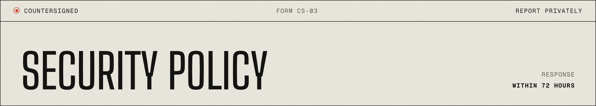

<a href="README.md">README</a> &nbsp;·&nbsp; <a href="https://akiyo974.github.io/countersigned/">Website</a> &nbsp;·&nbsp; <a href="docs/concepts.md">Concepts</a> &nbsp;·&nbsp; <a href="CONTRIBUTING.md">Contributing</a> &nbsp;·&nbsp; <a href="SECURITY.md">Security</a>

---

## § 01 · Supported versions

While the project is below 1.0, only the latest minor release receives fixes.

## § 02 · Reporting a vulnerability

countersigned is a safety layer, so a bypass is a serious bug. Examples of what counts:

- applying a plan that was not approved, or that differs from the approved hash
- an agent obtaining approval through the MCP server, or approving its own plan
- a step executing twice for the same plan
- a ledger edit, insertion or deletion that `countersigned ledger verify` does not detect
- a way for the agent to make `apply` run a step again, or skip the drift or expiry checks
- apply proceeding despite observed drift or broken preconditions
- path traversal or injection through plan ids, action input or MCP messages

**Do not open a public issue.** Report privately at
<https://github.com/Akiyo974/countersigned/security/advisories/new>
(Security tab, "Report a vulnerability").

What to expect:

- acknowledgement within 72 hours;
- an assessment and a fix plan within 7 days;
- a coordinated release and a published advisory, with credit unless you prefer otherwise.

## § 03 · Threat model

- **Untrusted:** the agent and everything it sends (tool arguments, plan content, retries).
- **Trusted:** the operator, the host running the store, and the code of registered actions.
- Out of scope: an attacker who already controls the host or can write the store directly. The ledger is tamper-evident, not tamper-proof; publish `countersigned ledger head` outside the host and verify with `--head` if that matters.

## § 04 · Hardening checklist for deployments

- Never expose `resume()` to an agent; it is an operator action, after confirming the original process is gone.

- Run the MCP server with credentials scoped to the actions you registered, nothing more.
- Keep the store directory out of the agent's reach (a coding agent with shell access must not be able to write `.countersigned/`).
- Use `rules.irreversibleNeedsApproval()` and `rules.maxEffects()` in production.
- Forward idempotency keys to downstream systems and use their concurrency control (ETags, row versions) in `execute()`.
