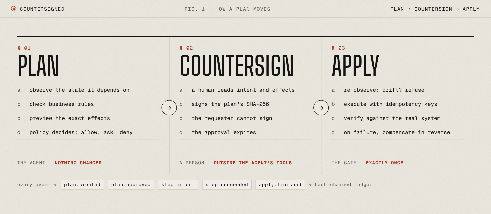
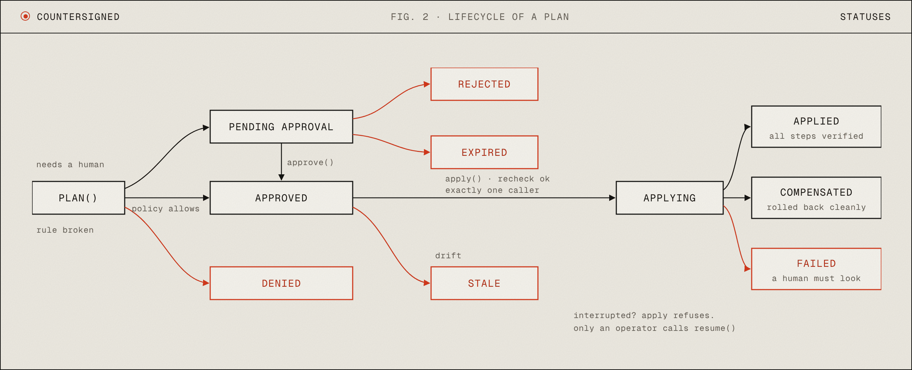

<a href="../README.md">README</a> &nbsp;·&nbsp; <a href="https://akiyo974.github.io/countersigned/">Website</a> &nbsp;·&nbsp; <a href="../docs/concepts.md">Concepts</a> &nbsp;·&nbsp; <a href="../CONTRIBUTING.md">Contributing</a> &nbsp;·&nbsp; <a href="../SECURITY.md">Security</a>

---

## § 01 · Lifecycle of a plan

- **applying**: one caller owns the apply. Any other `apply()` is refused with `APPLY_IN_PROGRESS`. If the process died, an operator calls `resume()` (never the agent).
- **applied**: every step executed and verified.
- **compensated**: a step failed; every earlier effect was undone. The system is back where it was.
- **failed**: a step failed and at least one effect could not be undone (irreversible, compensation error, or unknown outcome). `report.unrecoverable` says exactly which.

## § 02 · Reversibility

| Level | Meaning | compensate() | Default policy |
| --- | --- | --- | --- |
| `read` | no side effect | not allowed | allow |
| `reversible` | the way back restores the exact previous state | required | needs approval |
| `compensable` | a correction exists but the world remembers (refund, reschedule back) | required | needs approval |
| `irreversible` | no way back (email, shipment, phone call) | forbidden | needs approval |

Put irreversible steps last in a plan when you can: if an earlier step fails, nothing irreversible has happened yet.

## § 03 · The plan hash

SHA-256 over canonical JSON of: id, creation and expiry time, intent, requester, and for each step the action, validated input, observed state hash, previewed effects and decision. Status, approval and report are excluded (they describe the plan's life, not its content). An approval records the hash it saw; `apply` refuses if the stored plan no longer matches it.

## § 04 · Idempotency keys

`cs_` + the first 32 hex chars of `sha256(planHash + ":" + stepIndex)`. Stable across retries and restarts, unique per step. Forward it: an `Idempotency-Key` header, an external document number, a dedupe column. That is what makes "execute threw, did it happen?" answerable.

## § 05 · Ledger events

`plan.created`, `plan.approved`, `plan.denied`, `plan.rejected`, `plan.expired`, `plan.stale`, `apply.started`, `step.intent` (written before the side effect), `step.succeeded`, `step.verify_failed`, `step.failed`, `step.compensated`, `step.compensation_failed`, `apply.finished`.

Each entry stores `prevHash` and its own `hash`; changing, inserting or removing an entry breaks every following link.

## § 06 · Writing good actions

- **observe** only what the action depends on. Observing a whole table makes every unrelated edit look like drift.
- **check** returns sentences a human understands. They are shown to the model too, which then explains the blocker to the user instead of retrying blindly.
- **preview** is a promise. If it says `3 -> 6`, verify must check for 6.
- **verify** re-reads the system of record. Comparing to `execute`'s return value proves nothing.
- **compensate** must be safe to run twice.
- **description** is written for the model: what, when, and what it will not do.
